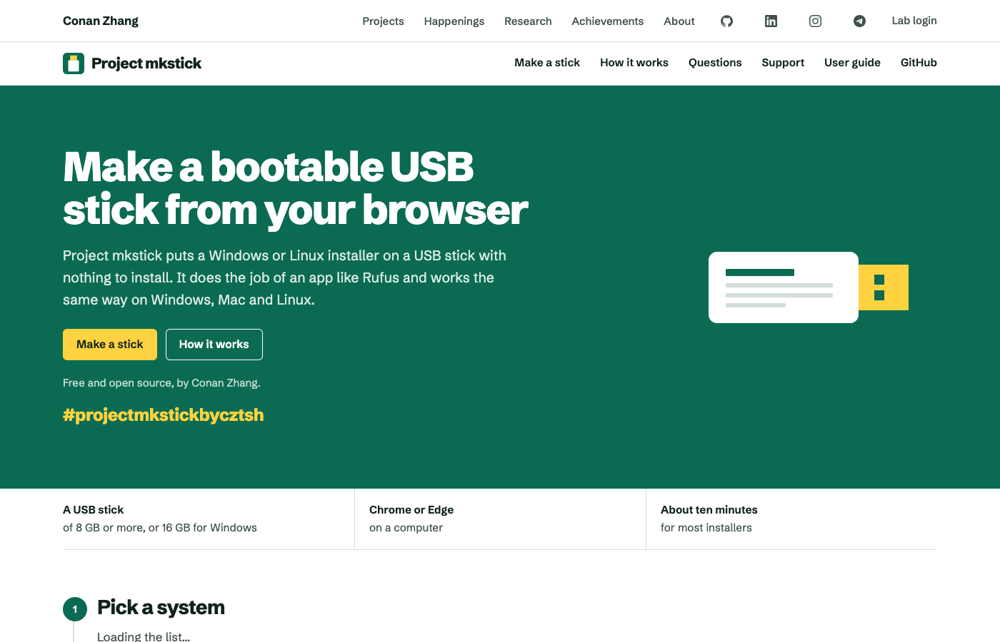
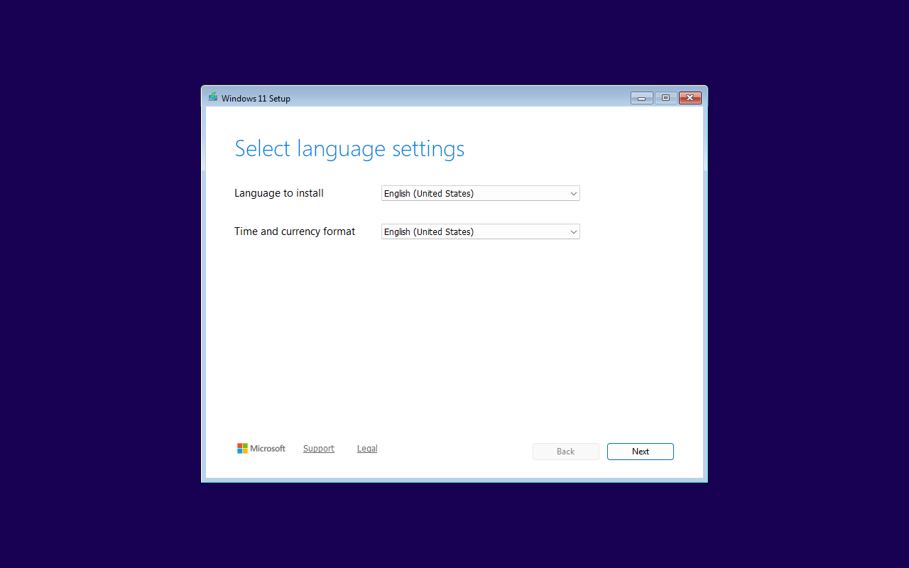
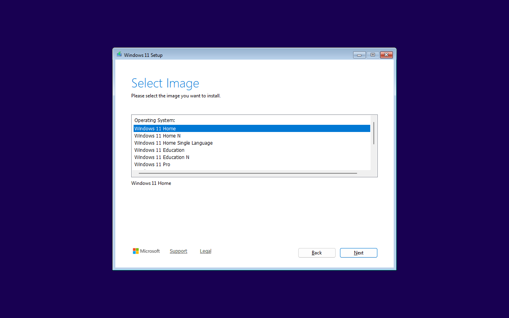
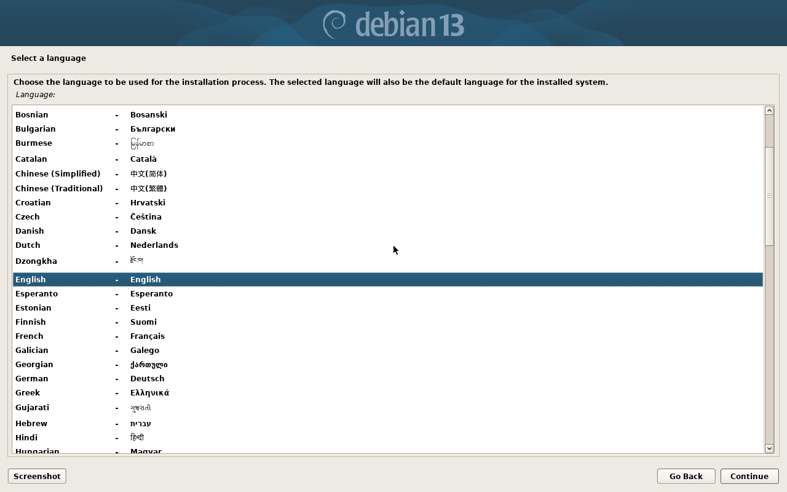
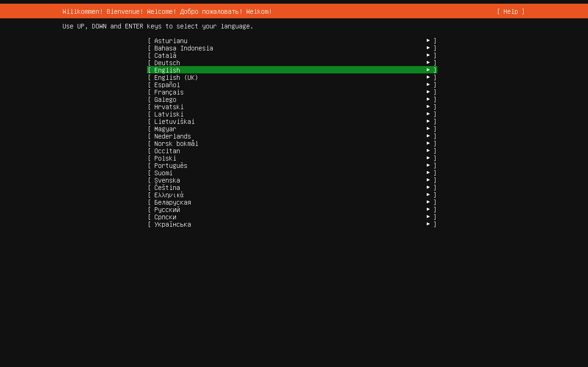
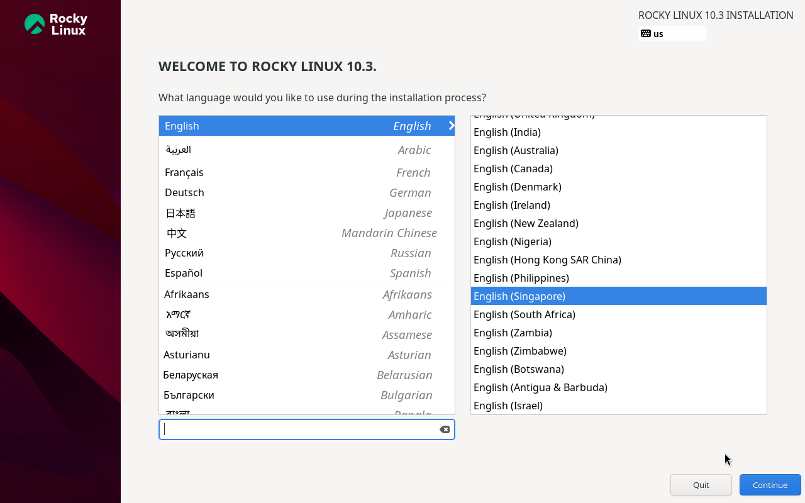
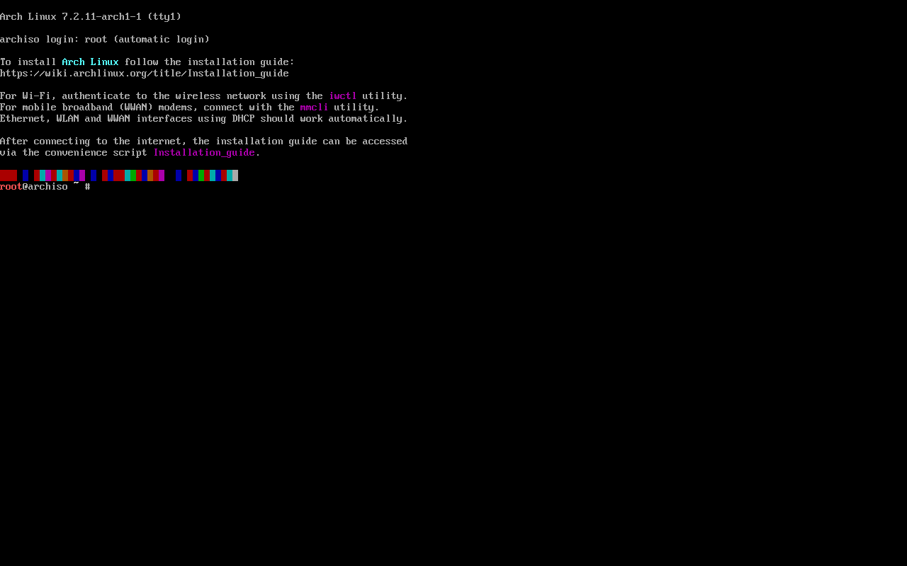
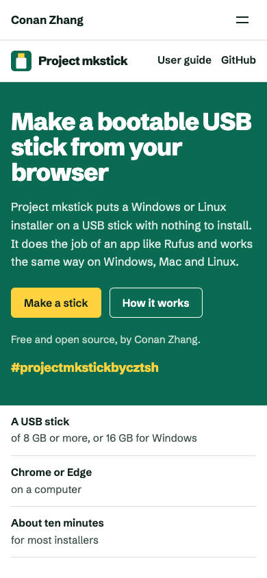

# Project mkstick

[](LICENSE) [](https://github.com/sponsors/conanzhangtech)

**Make a bootable Windows or Linux USB stick from a web page.** Nothing to install. It does the job of an app like Rufus, and works the same on Windows, Mac and Linux. Free and open source.

[**Open the site**](https://mkstick.czt.sh) · [User guide](https://docs.open.czt.sh/projectmkstick/) · [Technical docs](docs/PROJECT.md) · [Write-up](https://czt.sh/projects/mkstick)



## How to use it

1. Open [mkstick.czt.sh](https://mkstick.czt.sh) in Chrome or Edge on a computer.
2. Pick a system: Windows, Windows Server, Ubuntu, Debian, Mint, Arch, Rocky, Alma, Alpine or your own ISO file.
3. Plug in an empty FAT32 USB stick and choose it.
4. Press the button. Wait until it says it is done, then start your PC from the stick.

## What it can make

| System | Where the installer comes from |
| --- | --- |
| Windows 11 and 10 | Microsoft. Your browser downloads the file, then you choose it. |
| Windows Server 2025, 2022 and 2019 | Microsoft's free 180-day evaluation. Download it there, then choose the file. |
| Ubuntu Desktop and Server (26.04 and 24.04) | Ubuntu's own server, checked against its published checksum |
| Debian (network installer, or Live GNOME) | Debian's own server, checked against its published checksum |
| Linux Mint (Cinnamon), Arch Linux, Alpine Linux | Each one's own server, checked against its checksum |
| Rocky Linux and AlmaLinux 9 and 10 (network installers) | Each one's own server, checked against its checksum. The PC needs internet when you install. |
| Anything else | An ISO file you already have |

Arch Linux only starts from a stick named `ARCH_202611`, and the page tells you this before you choose the stick.

## Proof it works

These are sticks made by the engine, started in a virtual PC.

| Windows Setup | Windows editions found |
| --- | --- |
|  |  |

| Debian installer | Ubuntu Server installer |
| --- | --- |
|  |  |

| Rocky Linux 10 installer | Arch Linux |
| --- | --- |
|  |  |

Also tested on a real USB stick, written from the browser.

In Safari, Firefox and on phones the buttons are switched off, because those browsers cannot write to a drive: 

## How it works

- The page reads a disc image (ISO) and copies its files to a FAT32 stick the user picks. Chrome and Edge allow this through the File System Access API. Safari, Firefox and phones do not.
- Windows images come from Microsoft. The page links to Microsoft's download page, the user downloads the ISO there and then chooses that file. Microsoft's servers do not let a web page read the download directly, so this step cannot be skipped.
- A scheduled job (`jobs/`) fetches official Windows download links from Microsoft every six hours and hands them to the Worker, which keeps them for 23 hours. The page uses a stored link for a one-click download. Microsoft rejects these requests from Cloudflare's network and accepts them from GitHub's runners, which is why a job does it.
- Linux images are read in pieces through the Worker from the publisher's own server, and checked against the publisher's SHA-256.
- `install.wim` is larger than FAT32 allows, so it is split into `install.swm`, `install2.swm` and so on. Nothing is decompressed.
- The Worker stores no disc images.

## Layout

| Path | What it is |
|---|---|
| `public/index.html`, `app.js`, `style.css` | The page |
| `public/lib/udf.js` | Reads Windows discs (UDF) |
| `public/lib/iso9660.js` | Reads Linux discs (ISO 9660, Rock Ridge, Joliet) |
| `public/lib/wim.js` | Plans the `install.wim` split |
| `public/lib/flash.js` | Builds the list of files to write, then writes them |
| `public/lib/source.js` | Reads a local file or a remote file in pieces |
| `public/vendor/sha256.umd.min.js` | hash-wasm 4 (MIT), for the checksum |
| `public/fonts/` | Schibsted Grotesk (SIL Open Font Licence) |
| `src/index.js` | Worker: catalogue, Microsoft link, mirror pass-through |
| `jobs/` | Scheduled job that fetches Windows download links from Microsoft |
| `docs/PROJECT.md` | Full project documentation |
| `test/security-check.mjs` | Checks a running site against the security rules |
| `public/supporters.json` | The names on the supporters wall, edited by hand |
| `public/qr/`, `tools/make-qr.mjs` | QR codes for the donation addresses, and the script that draws and checks them |
| `.github/FUNDING.yml` | Turns on the Sponsor button on GitHub |
| `test/flash-cli.mjs` | Runs the same engine from the command line |
| `test/proof/` | Screenshots of sticks made by the engine starting in a virtual PC |

## Header and footer

The Worker reads the header and footer from the main site (`MAIN_SITE` in `src/index.js`) once an hour and puts them into the page, so links and labels follow the main site. Their styles are in `public/style.css` and are not synced. If the main site cannot be reached, the copy in `index.html` is shown. To run mkstick under another site, change `MAIN_SITE` or remove `siteFrame`.

## Run it

```bash
npx wrangler dev -c mkstick.czt.sh/wrangler.jsonc --port 8794
```

Add `?target=opfs` to the address to write to a private folder inside the browser instead of a stick. This is for testing.

```bash
node test/flash-cli.mjs path/to/image.iso path/to/empty/folder
```

## Deploy

```bash
npx wrangler deploy
```

Change `routes` in `wrangler.jsonc` to your own domain first. If your login has more than one account, set `CLOUDFLARE_ACCOUNT_ID`.

## Security

See [SECURITY.md](SECURITY.md). In short: a strict Content-Security-Policy, no third-party requests, rate limits, a locked-down pass-through, and no trust in file names read from a disc image.

## Limits

- Chrome or Edge on a computer.
- The stick must already be FAT32. A web page cannot format a drive.
- The stick starts UEFI PCs only.
- A Linux image with a single file over 4 GB cannot be written.
- ESD and "solid" Windows images cannot be split.

## Support

Project mkstick is free and has no adverts. If it saved you time, you can say thanks:

| Way to give | Link | Notes |
| --- | --- | --- |
| GitHub Sponsors | [github.com/sponsors/conanzhangtech](https://github.com/sponsors/conanzhangtech) | Monthly or one-off |
| Ko-fi | [ko-fi.com/conanzhangtech](https://ko-fi.com/conanzhangtech) | A one-off tip, no account needed |
| PayPal | [paypal.me/conanzhangtech](https://paypal.me/conanzhangtech) | Any amount |

**Crypto (USDT).** Send only on the network named in the table. Coins sent on another network cannot be recovered. Check the first and last few characters of the address before you send.

| Network | Address | QR code |
| --- | --- | --- |
| Ethereum (ERC-20) | `0x8Cc894EED2c98BEFB42477fd15868f59fa7D9C16` |  |
| Tron (TRC-20) | `TGHTXkjC8CpdLHF5g2m2RVsZ5QgzhyDWFi` |  |

More ways to give are on the [support page](https://mkstick.czt.sh/#support). Starring the repository and telling a friend help too.

Makes a bootable Windows or Linux USB stick from a web page. No app to install. Free and open source under the MIT licence.

Site: https://mkstick.czt.sh

Write-up: https://czt.sh/projects/mkstick
